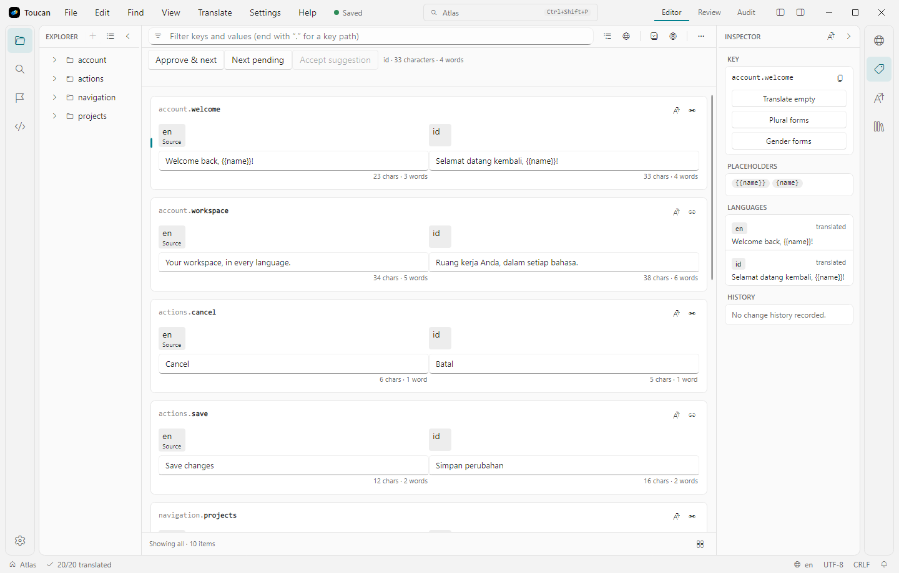

<div align="center">
  
  <h1>Toucan</h1>
  <p>A desktop workspace for software translation files.</p>
  <p><a href="https://github.com/rasyidf/Toucan/releases">Download</a> · <a href="docs/user-guide.md">User guide</a> · <a href="docs/translator-guide.md">Translator guide</a> · <a href="https://toucan.rasyid.dev">Website</a></p>
</div>

Translate, review and validate your project's languages in one place. Toucan runs on **Windows, macOS and Linux**, works with local resource files, and brings source text, target translations, context and quality checks into the same editor.

**v0.24 preview:** this is the [`release/v0.24.0`](https://github.com/rasyidf/Toucan/tree/release/v0.24.0) branch, based on the merged v0.23 development branch. The latest published release is **v0.23.0**. Settings and project files may change before 1.0. Native accessibility and packaged platform acceptance for v0.24 remain pending; see the [acceptance record](docs/specs/editor-comfort/acceptance.md).

<picture>
  <source media="(prefers-color-scheme: dark)" srcset="docs/assets/screenshots/editor-dark.png"/>
  <source media="(prefers-color-scheme: light)" srcset="docs/assets/screenshots/editor-light.png"/>
  
</picture>

*Current source build, rendered with a local sample project. The screenshot follows your light or dark theme.*

## Get started

1. [Download a release](https://github.com/rasyidf/Toucan/releases) for your platform: a portable Windows x64 zip, a macOS app in a DMG or zip, or a Linux tarball.
2. On first launch, choose your default language and theme. AI assistance is optional and off by default.
3. Drop a folder of translation files onto Toucan, choose **File → Open Folder**, or create a project from a framework template.
4. Select a target field, translate or accept a suggestion, then approve and save. The explorer and project commands appear when a project is open.

Toucan detects frameworks including i18next, Flutter, Android, iOS, .NET, Rails and Gettext. Existing BabelEdit `.babel` projects can be imported into a native Toucan project.

### What's new in v0.24

- Source-first, responsive translation cards with character and word counts, placeholder context and translation-memory provenance.
- Keyboard approval and next-pending navigation, plus grouped undo for bulk editing workflows.
- First-run language/theme setup, a dismissible feature tour and actionable notification history.
- Shared dialog title bars and a start screen that hides project-only menus and navigation until a project opens.
- Expanded resource compatibility, exact-resource handling and BabelEdit project migration. See the [changelog](CHANGELOG.md) for details and the [acceptance record](docs/specs/editor-comfort/acceptance.md) for outstanding release checks.

<details>
<summary>Opening the unsigned macOS app</summary>

Toucan is not signed with an Apple Developer ID. If Gatekeeper blocks the downloaded app, open it once, then use **System Settings → Privacy & Security → Open Anyway**. On macOS 14 and earlier, right-clicking the app and choosing **Open** also works.

</details>

## Editing and review

| Workflow | What Toucan provides |
|---|---|
| Translate with context | Source-first cards, side-by-side fields in wide windows, stacked fields in narrow windows, character/word counts, comments and an inspector. |
| Review by keyboard | Approve and advance through targets, find pending translations, and accept translation-memory suggestions. Editor, Review and read-only Audit modes support different stages of the work. |
| Work in bulk | Preview search/replace and pre-translation; copy, move, approve or delete selected keys. Grouped undo restores a batch in one step. |
| Catch mistakes | Missing translations, placeholder mismatches, duplicates, untranslated copies, empty values and whitespace checks. Rename named placeholders across languages. |
| Reuse translations | Fuzzy translation memory, match provenance, TMX import/export and inline ghost-text suggestions. |
| Stay focused | Zen mode, a searchable command palette, customizable shortcuts, light/dark themes, optional onboarding guidance and notification history with actions. |
| Find code context | Source scanning for translation calls, used/unused key filters and links back to source files. |

### Useful shortcuts

Use **Ctrl** on Windows/Linux and **Cmd** on macOS.

| Shortcut | Action |
|---|---|
| Ctrl/Cmd+O | Open a project folder |
| Ctrl/Cmd+S | Save |
| Ctrl/Cmd+Enter | Approve and move to the next target |
| Ctrl/Cmd+Alt+→ | Find the next pending target |
| Tab | Accept an inline translation-memory suggestion |
| Ctrl/Cmd+Shift+P | Open the command palette |
| Ctrl/Cmd+/ | Show the shortcut sheet |

See the [user guide](docs/user-guide.md) for the workspace and settings, or the [translator guide](docs/translator-guide.md) for the translation and review workflow.

## Formats and project compatibility

Toucan supports JSON, YAML, Gettext PO, RESX, Android XML, iOS `.strings`, XLIFF, Flutter ARB, CSV, TOML, Java `.properties` and Laravel PHP, alongside framework-specific layouts. INI is export-only; generated FormatJS catalogs are read-only sources. Plural and array handling depends on the format.

Read the [format support matrix](docs/formats.md) before round-tripping an existing project. It lists retained metadata, supported syntax and save restrictions. The [compatibility specification](docs/specs/resource-compatibility) documents exact-resource identity, BabelEdit import and remaining platform acceptance work.

## Translation providers and AI

Pre-translate with **Google Translate, DeepL, Microsoft Translator, a custom webhook or AI**. Review the preview before applying results. Provider configuration can be app-wide or specific to one project.

AI is off until enabled. Connect Claude, OpenAI-compatible services (including local servers), or Gemini for translation, analysis and source-clarity checks. [Prompts](Toucan.Core/Ai/Prompts) are editable globally or per project. API keys are kept outside project folders in the user's encrypted secret store.

Read [provider settings](docs/provider-settings.md), [AI integration](docs/ai-integration.md) and [pre-translation previews](docs/pretranslation-preview.md) for configuration and behavior.

## CLI and plugins

The `toucan` CLI supports validation, progress statistics, translation, export and key-level operations. From a source checkout:

```bash
dotnet run --project Toucan.CLI -- check ./locales
dotnet run --project Toucan.CLI -- stats ./locales
dotnet run --project Toucan.CLI -- list-formats
```

Plugins can add formats, providers, validation rules, framework profiles and desktop contributions. Enable and trust plugins through **Settings → Plugins** or the CLI's `plugins` commands. Start with the [plugin guide and SDK reference](docs/plugins.md) and [sample projects](samples).

## Build from source

Install the **.NET 10 SDK** (SDK selection is in [global.json](global.json)), then run:

```bash
git clone --branch release/v0.24.0 https://github.com/rasyidf/Toucan.git
cd Toucan
dotnet restore Toucan.CrossPlatform.slnx
dotnet build Toucan.CrossPlatform.slnx --no-restore
dotnet run --project Toucan.Avalonia
```

Run the regression suites with:

```bash
dotnet test Toucan.CrossPlatform.slnx
```

If the test bridge stalls, the [acceptance record](docs/specs/editor-comfort/acceptance.md) includes direct xUnit runner commands and Windows junction-test requirements. See [architecture](docs/ARCHITECTURE.md) for the Avalonia/MVVM app, core services, format modules and plugin contracts. The version is defined in [Directory.Build.props](Directory.Build.props).

The WPF app was retired after v0.17.3 and remains on the [`legacy/wpf`](https://github.com/rasyidf/Toucan/tree/legacy/wpf) branch.

## Documentation and roadmap

- [User guide](docs/user-guide.md) and [translator guide](docs/translator-guide.md)
- [Format support](docs/formats.md), [known issues](docs/known-bugs.md) and [changelog](CHANGELOG.md)
- [Documentation index](docs/INDEX.md), including each document's status
- [Roadmap](docs/todos/future-roadmap.md) and [completed features](docs/completed-features.md)

The v0.24 source build focuses on editor workflows, compatibility and the contextual desktop shell. Upcoming milestones cover glossary and review state, content-source synchronization, release packaging and performance. The roadmap records acceptance gates and planned order; it is not a delivery-date promise.

## Contributing

Report bugs and request features in [GitHub Issues](https://github.com/rasyidf/Toucan/issues). Include your OS, Toucan version, resource format and steps to reproduce. Pull requests are welcome; check the format support matrix and existing regression fixtures when changing file handling.

## License

[MIT](LICENSE.txt), copyright 2023–2026 Muhammad Fahmi Rasyid ([rasyid.dev](https://rasyid.dev)).
